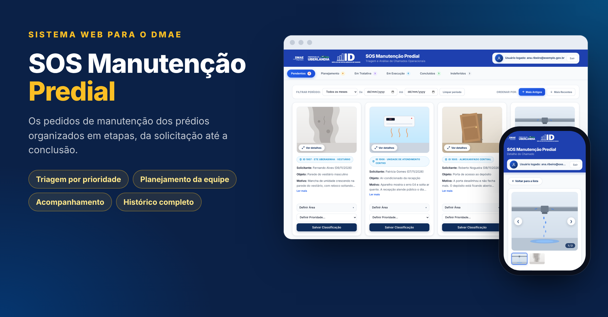
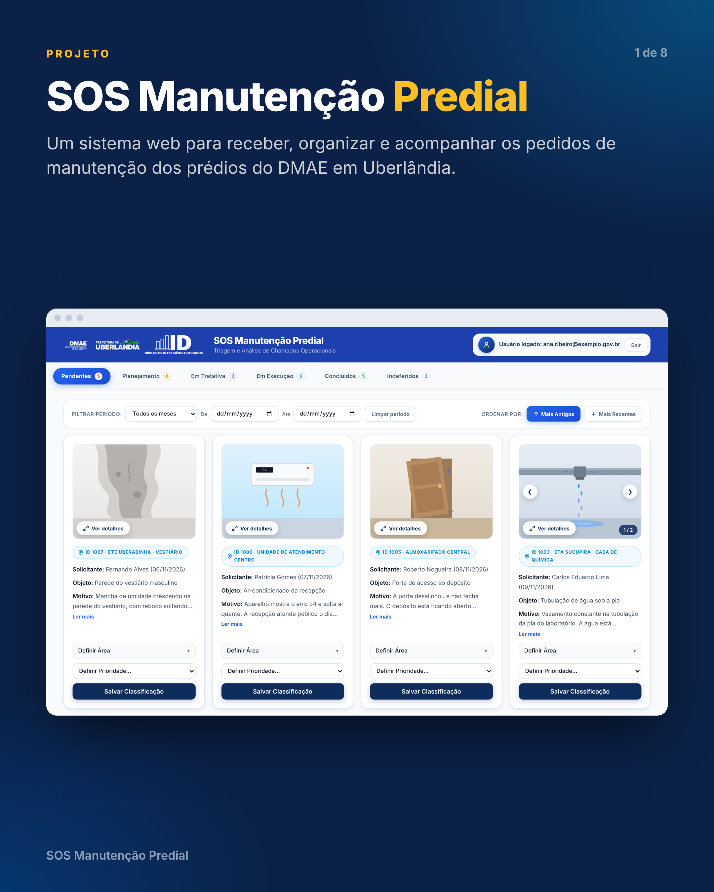
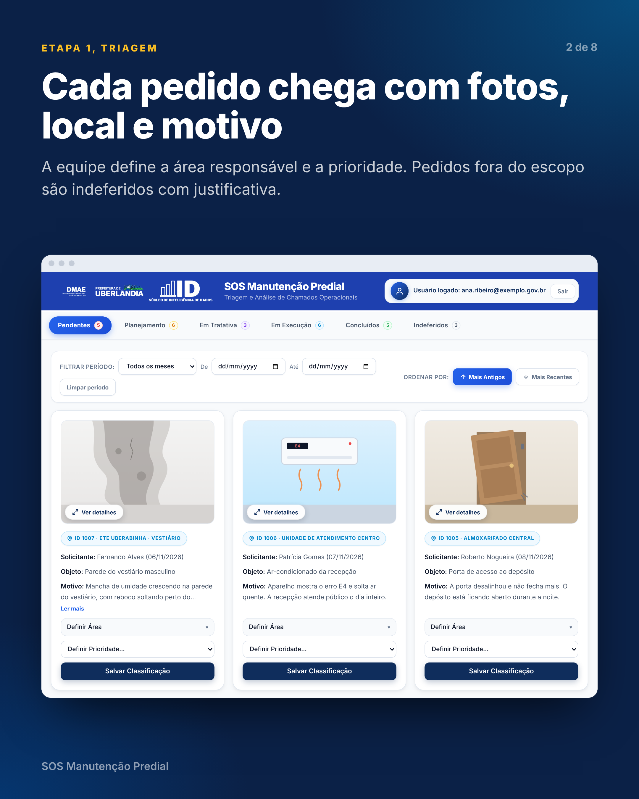
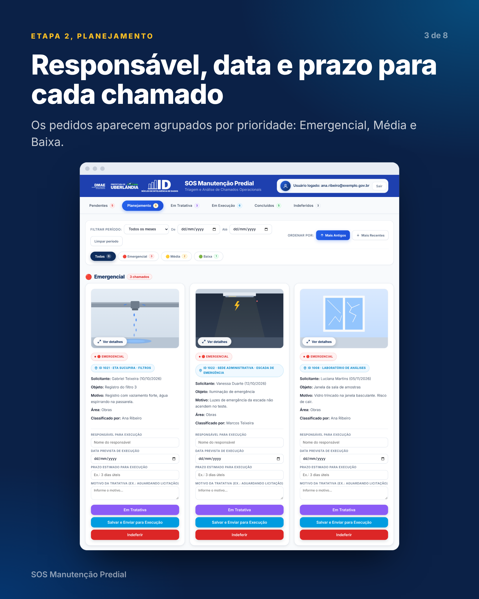
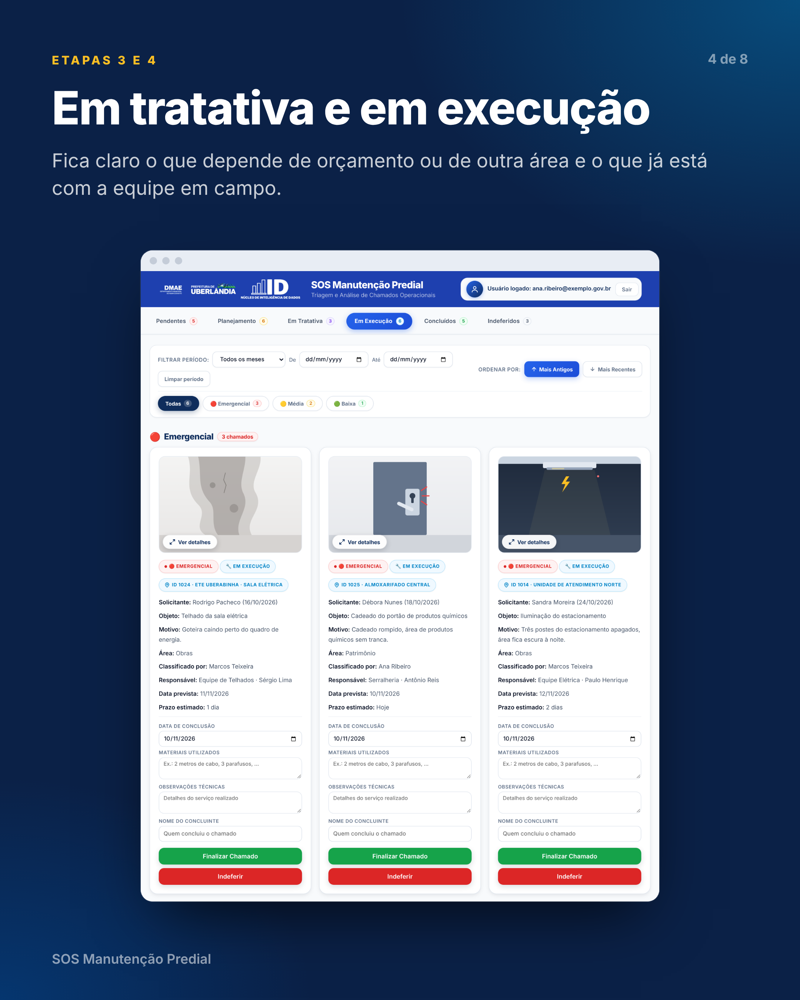
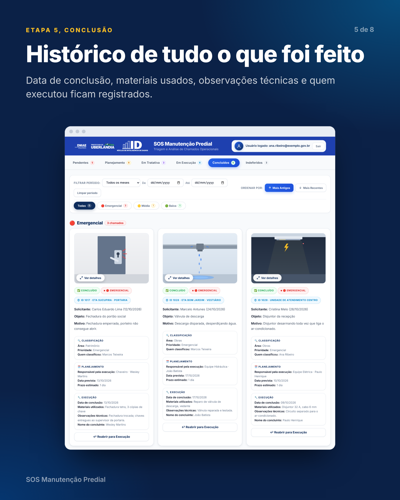
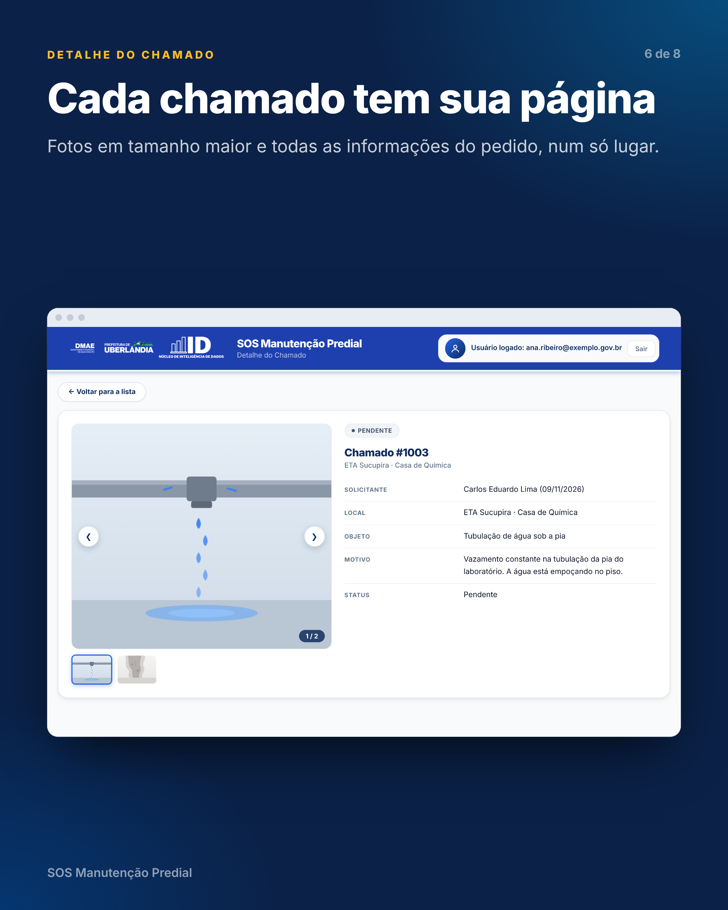
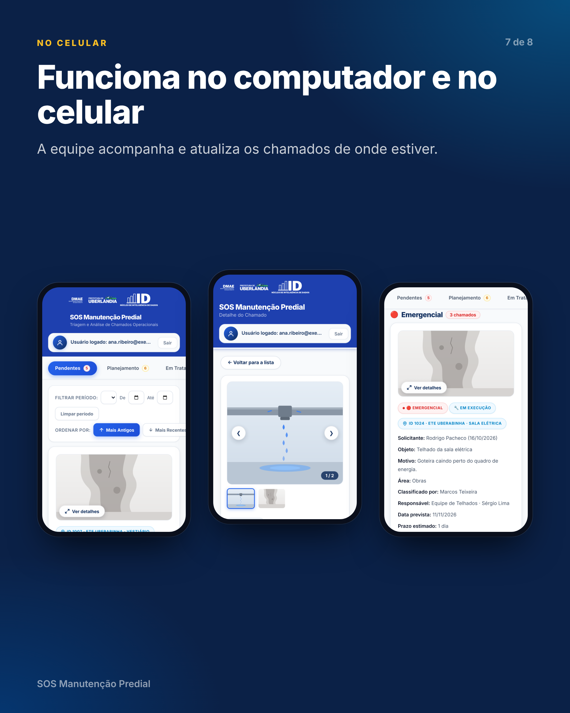
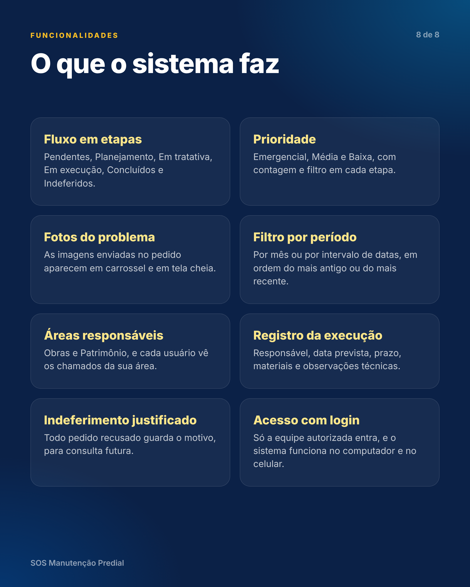

# 🏢 SOS Manutenção Predial

> **Plataforma web para gestão, triagem operacional e acompanhamento do ciclo de vida de ordens de serviço e manutenção predial pública.**

  

---

## 📌 Visão Geral

O **SOS Manutenção Predial** foi desenvolvido para modernizar e centralizar o fluxo de chamados de manutenção e infraestrutura do setor público. A solução substitui o controle descentralizado por um sistema com atualização contínua, galeria de fotos para inspeção e controle de acesso por departamento.

---

## 🖼️ Telas do Sistema

| | |
|:---:|:---:|
|  |  |
|  |  |
|  |  |
|  |  |

> As imagens usam dados fictícios de demonstração.

---

## 🚀 Principais Funcionalidades

* **Triagem Ágil de Chamados:** registro de pedidos com matriz de prioridade (Emergencial, Média, Baixa) e encaminhamento por setor (Patrimônio ou Obras).
* **Gestão do Ciclo de Vida Completo:** rastreabilidade por etapas: *Pendentes*, *Planejamento*, *Em Tratativa*, *Em Execução*, *Concluídos* e *Indeferidos*.
* **Inspeção Visual Integrada:** carrossel de fotos e *lightbox* nos cartões para validação e auditoria rápida das ocorrências.
* **Filtros e Consulta Histórica:** filtro por intervalo de datas, por mês e ordenação cronológica, com o estado salvo no navegador.
* **Autenticação Segura:** controle de acesso via Supabase Auth, com visualização dos chamados por área.

---

## 🛠️ Decisões de Arquitetura e Engenharia

* **Resiliência nas Requisições HTTP:** chamadas à API com limite de tempo e novas tentativas automáticas, tratando *cold starts* e instabilidades pontuais do backend.
* **Cache Local e Atualização em Segundo Plano:** cache com tempo de validade (TTL) e atualização periódica, mantendo a interface rápida sem apagar formulários em preenchimento.
* **Zero Dependências Pesadas:** construído em JavaScript moderno (Vanilla ES6+), com carregamento rápido, baixo consumo de memória e manutenção simples.

---

## 🏛️ Contexto de Aplicação

Desenvolvido para atender às necessidades operacionais do **DMAE (Departamento Municipal de Água e Esgoto)** em parceria com o **Núcleo de Inteligência de Dados (NID)** da **Prefeitura de Uberlândia**, garantindo transparência, métricas operacionais confiáveis e menor tempo de resposta nos reparos prediais.
